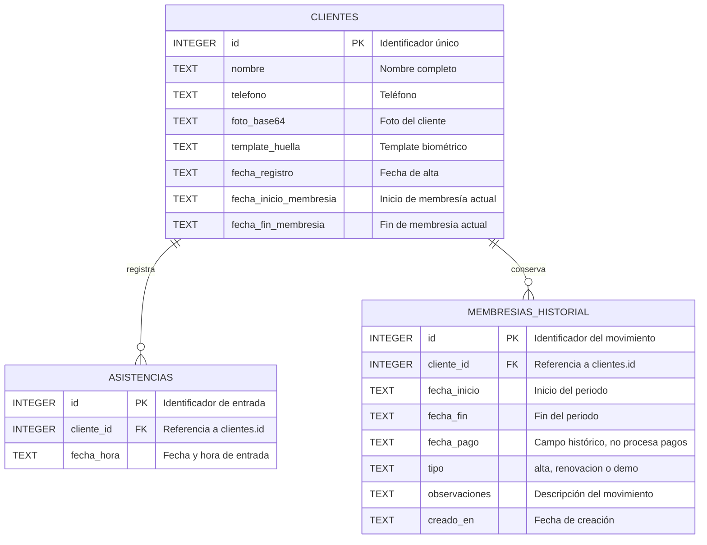
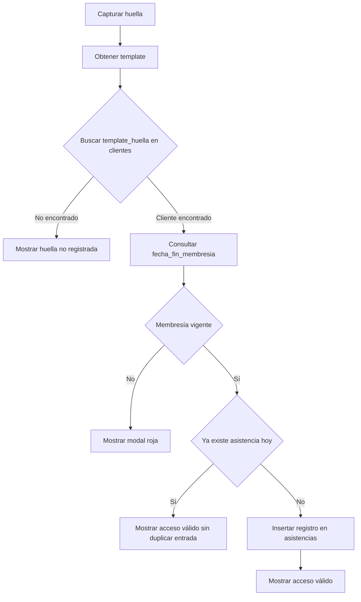
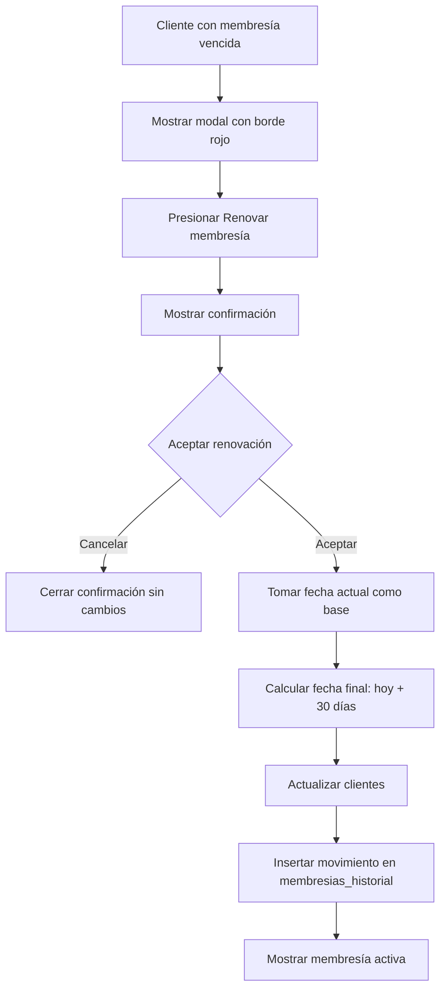

# Arquitectura de la base de datos

Este documento describe la base de datos utilizada por VIRTUS GYM, sus tablas, relaciones y los flujos principales de check-in y renovación de membresías.

## 1. Base utilizada

### Aplicación nativa Tauri

La aplicación de escritorio utiliza:

- **Motor:** SQLite.
- **Archivo:** `gym.db`.
- **Ruta principal:** `%LOCALAPPDATA%\Logym\gym.db`.
- **Resolución de la ruta:** la aplicación obtiene la carpeta local de datos de Tauri y abre `gym.db` dentro de ella.

En Windows, la ruta normalmente corresponde a:

```text
C:\Users\<usuario>\AppData\Local\Logym\gym.db
```

La lógica de apertura y creación del esquema se encuentra en [`src-tauri/src/database.rs`](../src-tauri/src/database.rs).

Si existe un archivo `gym.db` legado en el directorio de trabajo, la aplicación puede copiarlo inicialmente a la carpeta local de datos. El archivo original no se elimina.

### Modo web demo

Cuando la aplicación se ejecuta en el navegador mediante Vite, no existe acceso directo al backend Tauri ni a SQLite. En ese caso se activa un modo demo en [`src/services/tauriApi.js`](../src/services/tauriApi.js).

El modo web demo:

- No abre `gym.db`.
- No modifica la base SQLite.
- Simula un cliente de prueba.
- Simula la captura y búsqueda de huella.
- Simula el registro de asistencia.
- Permite visualizar estados activos y vencidos.
- Mantiene los mismos contratos de servicio que la aplicación Tauri.

Por lo tanto, un cambio realizado en la base SQLite no necesariamente aparecerá en `http://localhost:5173`. El navegador y la aplicación Tauri son dos entornos de datos distintos.

## 2. Diagrama entidad-relación



## 3. Estructura de tablas

## 3.1 Tabla `clientes`

Es la tabla principal de personas registradas.

| Columna | Tipo SQLite | Clave | Descripción |
| --- | --- | --- | --- |
| `id` | `INTEGER` | `PRIMARY KEY AUTOINCREMENT` | Identificador único del cliente. |
| `nombre` | `TEXT` | `NOT NULL` | Nombre completo. |
| `telefono` | `TEXT` | — | Teléfono del cliente, opcional. |
| `telefono_emergencia` | `TEXT` | — | Teléfono de emergencia, opcional. |
| `foto_base64` | `TEXT` | — | Imagen almacenada como cadena Base64 o Data URI. |
| `template_huella` | `TEXT` | — | Identificador/template biométrico asociado. |
| `fecha_registro` | `TEXT` | `DEFAULT CURRENT_TIMESTAMP` | Fecha de alta del cliente. |
| `fecha_inicio_membresia` | `TEXT` | `DEFAULT date('now')` | Inicio de la membresía vigente. |
| `fecha_fin_membresia` | `TEXT` | `DEFAULT date('now', '+30 day')` | Fin de la membresía vigente. |

Las fechas de membresía en `clientes` representan el periodo actual y permiten consultar rápidamente el estado del cliente sin recorrer todo el historial.

El estado se calcula dinámicamente:

```text
fecha_fin_membresia < hoy        -> vencida
fecha_fin_membresia <= hoy + 7   -> por_vencer
fecha_fin_membresia > hoy + 7    -> activa
```

No existe una columna persistida `estado_membresia`; el estado se deriva de las fechas.

## 3.2 Tabla `asistencias`

Registra las entradas válidas al gimnasio.

| Columna | Tipo SQLite | Clave | Descripción |
| --- | --- | --- | --- |
| `id` | `INTEGER` | `PRIMARY KEY AUTOINCREMENT` | Identificador de la entrada. |
| `cliente_id` | `INTEGER` | `NOT NULL`, `FOREIGN KEY` | Cliente que realizó la entrada. |
| `fecha_hora` | `TEXT` | `DEFAULT CURRENT_TIMESTAMP` | Fecha y hora del check-in. |

Relación:

```text
clientes.id 1 ---- N asistencias.cliente_id
```

La tabla tiene el índice:

```text
idx_asistencias_cliente_fecha (cliente_id, fecha_hora)
```

Este índice ayuda a consultar las asistencias de un cliente y validar el límite diario.

## 3.3 Tabla `membresias_historial`

Conserva los periodos y movimientos administrativos de membresía.

| Columna | Tipo SQLite | Clave | Descripción |
| --- | --- | --- | --- |
| `id` | `INTEGER` | `PRIMARY KEY AUTOINCREMENT` | Identificador del movimiento. |
| `cliente_id` | `INTEGER` | `NOT NULL`, `FOREIGN KEY` | Cliente relacionado. |
| `fecha_inicio` | `TEXT` | `NOT NULL` | Inicio del periodo registrado. |
| `fecha_fin` | `TEXT` | `NOT NULL` | Fin del periodo registrado. |
| `fecha_pago` | `TEXT` | `NOT NULL` | Nombre histórico; actualmente no representa un pago. |
| `tipo` | `TEXT` | `DEFAULT 'renovacion'` | Tipo de movimiento: `alta`, `renovacion` o `demo`. |
| `observaciones` | `TEXT` | — | Descripción administrativa. |
| `creado_en` | `TEXT` | `DEFAULT CURRENT_TIMESTAMP` | Momento en que se creó el registro. |

Relación:

```text
clientes.id 1 ---- N membresias_historial.cliente_id
```

La membresía actual se mantiene en `clientes` para consultas rápidas y cada alta o renovación se conserva en `membresias_historial` para no perder la historia.

## 4. Relaciones

### `clientes` a `asistencias`

Es una relación **uno a muchos (1:N)**:

- Un cliente puede tener cero, una o muchas asistencias.
- Cada asistencia pertenece a un único cliente.
- La relación se realiza mediante `asistencias.cliente_id`.

Ejemplo:

```text
CLIENTES
id = 1, nombre = Alex Rivera

ASISTENCIAS
cliente_id = 1, fecha_hora = 2026-10-25 08:14:00
cliente_id = 1, fecha_hora = 2026-10-26 07:58:00
cliente_id = 1, fecha_hora = 2026-10-27 09:03:00
```

### `clientes` a `membresias_historial`

También es una relación **uno a muchos (1:N)**:

- Un cliente puede tener el alta inicial y varias renovaciones.
- Cada movimiento pertenece a un único cliente.
- La relación se realiza mediante `membresias_historial.cliente_id`.

Ejemplo:

```text
CLIENTES
id = 1, nombre = Alex Rivera

MEMBRESIAS_HISTORIAL
cliente_id = 1, tipo = alta,       fecha_inicio = 2026-09-01, fecha_fin = 2026-09-30
cliente_id = 1, tipo = renovacion, fecha_inicio = 2026-10-01, fecha_fin = 2026-10-30
```

## 5. Flujo de check-in



### Reglas del check-in

1. Se captura una huella.
2. Se busca el template en `clientes.template_huella`.
3. Se calcula el estado con `fecha_fin_membresia`.
4. Una membresía vencida no genera asistencia.
5. Una membresía activa o próxima a vencer puede registrar entrada.
6. La asistencia se guarda en `asistencias`.
7. El backend evita duplicar la entrada del mismo cliente el mismo día.

La validación de asistencia diaria utiliza una operación equivalente a:

```sql
INSERT INTO asistencias (cliente_id, fecha_hora)
SELECT ?1, CURRENT_TIMESTAMP
WHERE NOT EXISTS (
    SELECT 1
    FROM asistencias
    WHERE cliente_id = ?1
      AND date(fecha_hora) = date('now')
);
```

El resultado indica si se insertó una nueva entrada o si ya existía una asistencia para ese día.

## 6. Flujo de renovación mensual



La renovación:

- No recibe días configurables.
- Siempre dura 30 días.
- Usa el día actual como fecha de inicio.
- Actualiza `clientes.fecha_inicio_membresia`.
- Actualiza `clientes.fecha_fin_membresia`.
- Inserta un movimiento en `membresias_historial`.
- Requiere confirmación explícita.

## 7. Caja, pagos y cobros

Actualmente el sistema **no tiene**:

- Tabla de caja.
- Tabla de pagos.
- Registro de montos.
- Procesamiento de dinero.
- Integración con terminales o métodos de pago.
- Flujo de cobro en la interfaz.

La renovación es solamente un movimiento administrativo de vigencia de membresía.

### Campo histórico `fecha_pago`

La tabla actual conserva una columna llamada `fecha_pago` por compatibilidad con el esquema inicial. Actualmente:

- No almacena un monto.
- No confirma una transacción.
- No conecta con una caja.
- No procesa pagos.

El nombre recomendado para una migración futura es:

```text
fecha_pago -> fecha_movimiento
```

Ese cambio haría que el esquema refleje mejor el comportamiento real del sistema. Debe realizarse mediante una migración controlada para conservar los registros existentes.

## 8. Resumen del modelo

```text
CLIENTES
  Información principal y membresía vigente
       │
       ├── 1:N ASISTENCIAS
       │       Historial de entradas
       │
       └── 1:N MEMBRESIAS_HISTORIAL
               Historial de altas y renovaciones
```

La base está normalizada para esta primera etapa: los datos repetibles, como asistencias y renovaciones, viven en tablas independientes relacionadas mediante `cliente_id`.
